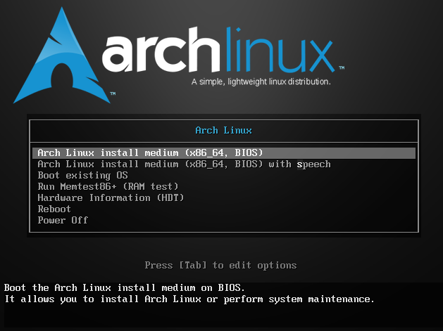
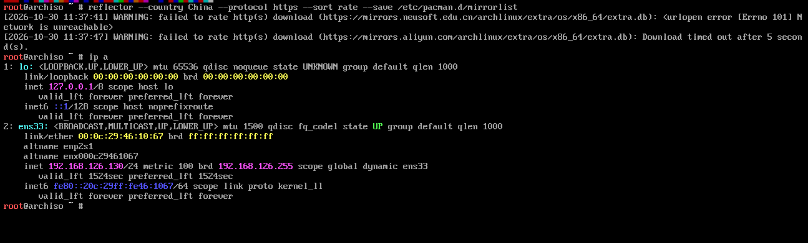
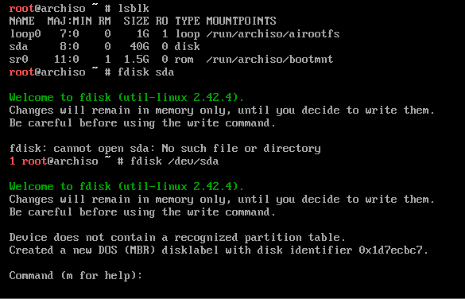
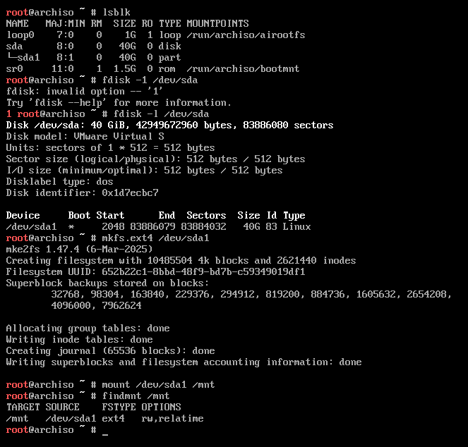
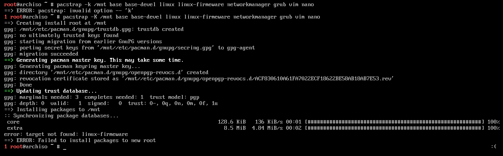
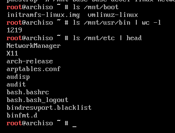
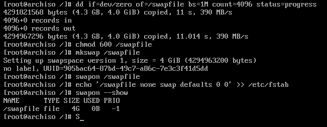
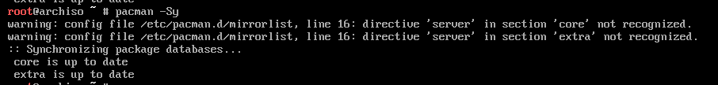
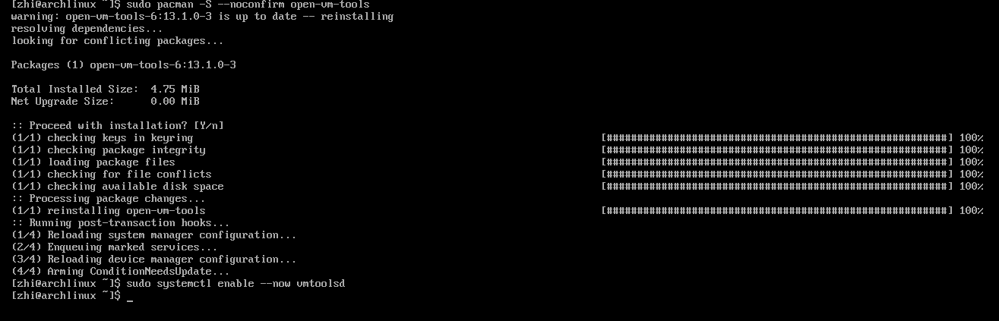
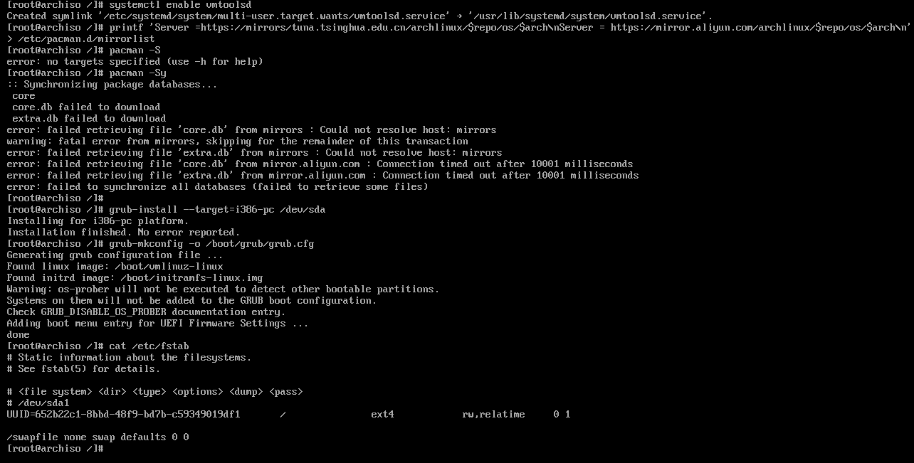

# 在 VMware 虚拟机中安装 Arch Linux

> 环境：VMware Workstation + Arch Linux 2026.10 ISO + Legacy（BIOS）固件 + 40 GB 虚拟磁盘。
> 本文按一次真实的完整安装过程整理，每一步都写了「为什么」和踩过的坑，可以直接照做。

## 0. 为什么是 Arch

Arch 是「装完只有基础系统」的发行版：不预装桌面、不预装服务，内核和用户态都交给用户自己组合。好处是干净、可控、对硬件和内核参数理解更深；代价是安装全程要自己敲命令。

本文选择 **Legacy BIOS + MBR + GRUB** 这条最传统的路线，在 VMware 里最省心：不需要处理 ESP 分区，也不涉及 UEFI 固件变量。

## 1. 创建虚拟机：几个关键设置

| 项目 | 建议值 | 说明 |
|---|---|---|
| 固件类型 | **BIOS**（不要 UEFI） | 与本文的 GRUB 安装方式对应 |
| 内存 | ≥ 2 GB（装桌面建议 4 GB） | 1 GB 能装但很慢 |
| 处理器 | 1–2 核 | 够用 |
| 硬盘 | 40 GB，精简置备 | 类型用默认 **SCSI/SATA**，设备名是 `/dev/sda`；不建议 NVMe，BIOS 引导 NVMe 可能有兼容问题 |
| CD/DVD | 指向 ISO，勾选「启动时连接」 | 启动顺序 CD 在前 |
| 显示 | **关闭「加速 3D 图形」** | 新版 ISO 在 VMware 开 3D 常黑屏/花屏 |
| 网络 | **NAT** | 开箱即用 DHCP，安装过程需要联网 |
| 声卡/打印机/软盘 | 可移除 | 省资源，不影响安装 |

## 2. 从 ISO 启动

开机后进入 Arch ISO 的引导菜单（Legacy 模式下是 syslinux 菜单），选第一项：

```
Arch Linux install medium (x86_64, BIOS)
```



进入 Live 环境后自动以 `root` 登录，提示符是 `root@archiso ~ #`。先确认自己处于 BIOS 还是 UEFI 模式：

```bash
ls /sys/firmware/efi
```

- 输出 `No such file or directory` → **Legacy BIOS**，与本文一致；
- 如果能列出 `efivars` 之类 → 是 UEFI 模式，引导方式完全不同（需要 ESP 分区 + `grub-install --target=x86_64-efi`），不要照抄第 8 节。

## 3. 联网与时间校准

VMware NAT 模式下，有线网卡由 `systemd-networkd` 自动 DHCP，基本不用配置：

```bash
ip a
ping -c 3 archlinux.org
timedatectl set-ntp true
```



### 关于 reflector 换源

很多人会先跑：

```bash
reflector --country China --protocol https --sort rate --save /etc/pacman.d/mirrorlist
```

两个注意点：

1. **它会整体覆盖** `/etc/pacman.d/mirrorlist`。测速时部分镜像失败，最终写进去的源可能很少，甚至出现格式坏行（后面第 7.8 节就踩了这个坑）。
2. 输出里的 `URL open error [Errno 101] Network is unreachable` 多半是**镜像域名解析到了 IPv6 而虚拟机没有 IPv6 路由**，IPv4 是好的，不影响安装。

所以更稳妥的做法是**直接写两个固定国内源**：

```bash
echo 'Server = https://mirrors.tuna.tsinghua.edu.cn/archlinux/$repo/os/$arch' > /etc/pacman.d/mirrorlist
echo 'Server = https://mirrors.aliyun.com/archlinux/$repo/os/$arch' >> /etc/pacman.d/mirrorlist
```

> `$repo` 和 `$arch` 必须保持原样，由 pacman 自己替换，不要让 shell 展开。

然后同步一次数据库验证：

```bash
pacman -Sy
```

## 4. 分区与格式化

确认磁盘：

```bash
lsblk
```

本机是 40 GB 的 `/dev/sda`，无分区。进入 fdisk：

```bash
fdisk /dev/sda
```



按下面顺序输入（每行一个按键）：

| 输入 | 作用 |
|---|---|
| `n` | 新建分区 |
| `p` | 主分区 |
| `1` | 分区号 1 |
| 回车 | 起始扇区默认 2048 |
| 回车 | 结束扇区默认，占满整盘 |
| `a` | 设置可引导标志 |
| `1` | 给分区 1 打 boot 标志 |
| `w` | 写入并退出 |

- 新磁盘会提示 `Created a new DOS (MBR) disklabel`，说明分区表已建好，**不要再按 `o`**。
- 40 GB 十进制容量在 fdisk 里显示为 `37.3 GiB`，是正常的单位换算。

格式化并挂载：

```bash
mkfs.ext4 /dev/sda1
mount /dev/sda1 /mnt
findmnt /mnt
```



**为什么用「单分区 + swapfile」而不是单独分 swap 分区？**
虚拟机磁盘小，单分区结构简单、不易分错；swap 用文件实现，随时可改大小、可 `swapoff` 删除，灵活性更高。

## 5. 安装基础系统（pacstrap）

```bash
pacstrap -K /mnt base base-devel linux networkmanager grub vim nano
```

- `-K`：在新系统里初始化 pacman 密钥环（生成 master key、导入 archlinux.gpg），装完后在新系统里装包不会报缺密钥。
- 预计耗时 2–5 分钟。

### 坑 1：`linux-firmware` 已经不存在这个包名

实测会报：

```
error: target not found: linux-firmware
ERROR: Failed to install packages to new root
```



原因是新版 Arch 已把 `linux-firmware` 拆成按厂商的子包（`linux-firmware-xxx`），单包名不再存在；pacman 遇到不存在的目标会**整单中止**，所以 `/mnt` 里一个包都没装上。

**处理**：虚拟机不需要任何固件文件（vmwgfx 显卡、e1000e/vmxnet 网卡、SCSI 控制器驱动都编译在内核里），直接把 `linux-firmware` 从列表删掉重跑：

```bash
pacstrap -K /mnt base base-devel linux networkmanager grub vim nano
```

装完验证：

```bash
ls /mnt/boot
ls /mnt/usr/bin | wc -l
```



应看到 `vmlinuz-linux`、`initramfs-linux.img`，且 `/usr/bin` 里有一千多个程序。

## 6. 生成 fstab

```bash
genfstab -U /mnt >> /mnt/etc/fstab
cat /mnt/etc/fstab
```

应有一行 `UUID=<你的分区UUID>  /  ext4  rw,relatime  0 1`。用 `-U` 是为了按 UUID 挂载，设备顺序变化时不会挂错。

## 7. chroot 进入新系统

```bash
arch-chroot /mnt
```

提示符变成 `[root@archiso /]#`，以下命令都在新系统里执行。

### 7.1 时区与时钟

```bash
ln -sf /usr/share/zoneinfo/Asia/Shanghai /etc/localtime
hwclock --systohc
```

第二条成功时无输出。若报 `Cannot access the Hardware Clock via any known method`，虚拟机里常见，可忽略，开机会由 NTP 校准。

### 7.2 语言

```bash
sed -i 's/^#en_US.UTF-8 UTF-8/en_US.UTF-8 UTF-8/; s/^#zh_CN.UTF-8 UTF-8/zh_CN.UTF-8 UTF-8/' /etc/locale.gen
locale-gen
echo 'LANG=en_US.UTF-8' > /etc/locale.conf
```

先保持 `en_US.UTF-8`：**纯文本控制台没有中文字体，用中文 locale 会乱码**，等装了桌面再改。

### 7.3 主机名与 hosts

```bash
echo 'arch-vm' > /etc/hostname
printf '127.0.0.1   localhost\n::1         localhost\n127.0.1.1   arch-vm.localdomain arch-vm\n' > /etc/hosts
```

### 7.4 root 密码

```bash
passwd
```

输入两次（屏幕不显示），看到 `password updated successfully`。

### 7.5 创建 4 GB swapfile

```bash
dd if=/dev/zero of=/swapfile bs=1M count=4096 status=progress
chmod 600 /swapfile
mkswap /swapfile
swapon /swapfile
echo '/swapfile none swap defaults 0 0' >> /etc/fstab
swapon --show
```



最后一行应看到 `/swapfile file 4G`。`PRI` 显示 `-1` 是手动 `swapon` 的默认优先级，正常。

### 7.6 开机服务

```bash
systemctl enable NetworkManager
systemctl enable systemd-timesyncd
```

前者管网络，后者用 NTP 保持时间准确。

### 7.7 普通用户与 sudo

```bash
useradd -m -G wheel -s /bin/bash zhi
passwd zhi
echo '%wheel ALL=(ALL:ALL) ALL' > /etc/sudoers.d/wheel
chmod 440 /etc/sudoers.d/wheel
```

用 `sudoers.d/` 而不是改主 `sudoers` 文件：独立、可回滚、不怕改坏。

### 7.8 给新系统也配上国内源（和踩坑 2 的复盘）

```bash
echo 'Server = https://mirrors.tuna.tsinghua.edu.cn/archlinux/$repo/os/$arch' > /etc/pacman.d/mirrorlist
echo 'Server = https://mirrors.aliyun.com/archlinux/$repo/os/$arch' >> /etc/pacman.d/mirrorlist
cat /etc/pacman.d/mirrorlist
```

> **坑 2**：一开始用一条长 `printf '...\n...'` 写这个文件，在虚拟机控制台里输入被截断，写出的 mirrorlist 坏掉了，导致 `pacman -Sy` 报 `Could not resolve host: mirrors` 和大量超时。
>
> 更早还出现过 `directive 'server' ... not recognized` 的警告——某行 `Server` 大小写不对，整行被 pacman 忽略：



**教训**：长命令在虚拟机控制台里很不可靠，宁可拆成多条短命令，写完用 `cat` 检查内容。

### 7.9 安装 VMware Tools

```bash
pacman -S --noconfirm open-vm-tools
systemctl enable vmtoolsd
```



装好后宿主机与虚拟机可以**互相复制粘贴**、窗口自适应分辨率、时间同步。若提示 `is up to date -- reinstalling`，说明之前已装，不影响。

## 8. 安装 GRUB（BIOS 模式）

```bash
grub-install --target=i386-pc /dev/sda
grub-mkconfig -o /boot/grub/grub.cfg
```



预期输出：

```
Installing for i386-pc platform.
Installation finished. No error reported.
```

```
Generating grub configuration file ...
Found linux image: /boot/vmlinuz-linux
Found initrd image: /boot/initramfs-linux.img
done
```

两个关键点：

1. `--target=i386-pc` 就是「给 Legacy BIOS 装引导」，设备必须是**整块磁盘** `/dev/sda`，写成 `/dev/sda1` 会报错。
2. `grub-mkconfig` 可能输出 `Warning: os-prober will not be executed...` 和 `Adding boot menu entry for UEFI Firmware Settings ...`。前者正常（单系统不需要探测其他系统）；后者在 BIOS 模式下是 GRUB 2.12+ 的已知噪音，那条菜单项无效但不影响启动，忽略即可。

## 9. 收尾与重启

先关 swap，再卸载，否则会报 `target is busy`：

```bash
swapoff /swapfile
cat /etc/fstab
ls -l /boot/grub/grub.cfg
exit
umount -R /mnt
reboot
```

**重启前把 ISO 断开**：VMware 菜单「虚拟机 → 可移动设备 → CD/DVD(IDE) → 断开连接」。否则又会从安装盘启动，回到安装菜单。

## 10. 首次登录与验证

重启后依次是：GRUB 菜单（5 秒倒计时）→ 内核日志 → `arch-vm login:`。

用 root 或刚才创建的普通用户登录，然后验证：

```bash
ip a                       # ens33 有 192.168.x.x
ping -c 3 archlinux.org
free -h                    # Swap 行 4.0Gi
swapon --show
systemctl is-active NetworkManager
sudo -v                    # 普通用户执行，无输出即 sudo 正常
```

如果网络没起来，先 `nmcli device status` 看状态，再 `nmcli device connect ens33`；仍不行检查 Windows 服务里的 `VMware NAT Service`。

## 11. 可选：安装图形桌面

系统默认只有文本控制台。VM 里两种主流选择：

### KDE Plasma（功能最全，建议 4 GB 内存）

```bash
sudo pacman -S --needed plasma-meta sddm konsole dolphin noto-fonts noto-fonts-cjk pipewire pipewire-pulse wireplumber alsa-utils
sudo systemctl enable sddm
reboot
```

### XFCE（轻量，2 GB 内存也流畅）

```bash
sudo pacman -S --needed xfce4 xfce4-goodies lightdm lightdm-gtk-greeter noto-fonts noto-fonts-cjk pipewire pipewire-pulse wireplumber alsa-utils
sudo systemctl enable lightdm
reboot
```

两个注意点：

1. `noto-fonts-cjk` 用来显示中文，不装的话中文会变成方块。
2. **在 VMware 里 KDE 登录时选 `Plasma (X11)`，不要选 Wayland**：vmwgfx 驱动在 X11 下最稳，Wayland 下可能黑屏或分辨率异常。

## 12. 踩坑清单

| 现象 | 原因 | 处理 |
|---|---|---|
| `pacstrap: invalid option -- 'k'` | 大小写敲错 | 参数是 `-K` |
| `error: target not found: linux-firmware` | 包已被拆成子包 | 从 pacstrap 列表删掉它，虚拟机不需要 |
| `Could not resolve host: mirrors` / 同步超时 | mirrorlist 被写坏（长命令被截断、坏行） | 用两条 `echo` 重写，`cat` 检查 |
| `directive 'server' ... not recognized` | 某行 `Server` 大小写/空格不对 | 整行重写 mirrorlist |
| `umount: /mnt: target is busy` | `/swapfile` 还在使用 | 先 `swapoff /swapfile` |
| 重启后又进安装菜单 | ISO 没断开 | 断开 CD/DVD 再重启 |
| 启动黑屏/花屏 | VMware 3D 加速 | 关闭「加速 3D 图形」 |
| `hwclock: Cannot access the Hardware Clock` | 虚拟机时钟实现 | 忽略，用 NTP 同步 |
| 提示 `Adding boot menu entry for UEFI Firmware Settings` | GRUB 2.12+ 在 BIOS 下的噪音 | 忽略 |
| 中文显示成方块 | 缺 CJK 字体 | 装 `noto-fonts-cjk` |

## 小结

整套流程可以概括成五步：**分区格式化 → pacstrap 装基础包 → genfstab → chroot 写配置 → 装引导器重启**。

真正容易出错的不是命令本身，而是：**固件模式（BIOS/UEFI）与引导器要匹配**、**包名随版本变化**（如 `linux-firmware`）、**虚拟机控制台里长命令输入不可靠**（拆成短命令并校验文件内容）、**卸载前先关 swap**。

装完这套基础系统，Arch 剩下的部分（桌面、输入法、开发环境）都可以按需增量安装，出问题也容易定位。

## 参考

- Arch Wiki 安装指南：<https://wiki.archlinux.org/title/Installation_guide>
- Arch Wiki GRUB：<https://wiki.archlinux.org/title/GRUB>
- Arch Wiki 安装到虚拟机：<https://wiki.archlinux.org/title/Install_Arch_Linux_on_a_virtual_machine>
- Arch Wiki VMware 客户机：<https://wiki.archlinux.org/title/VMware/Install_Arch_Linux_as_a_guest>
